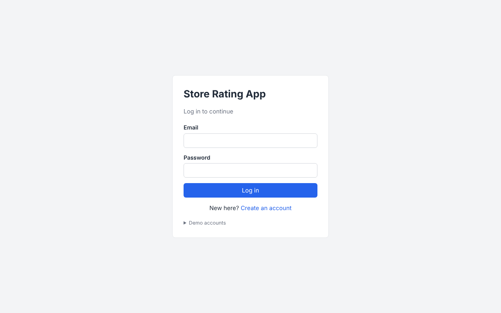
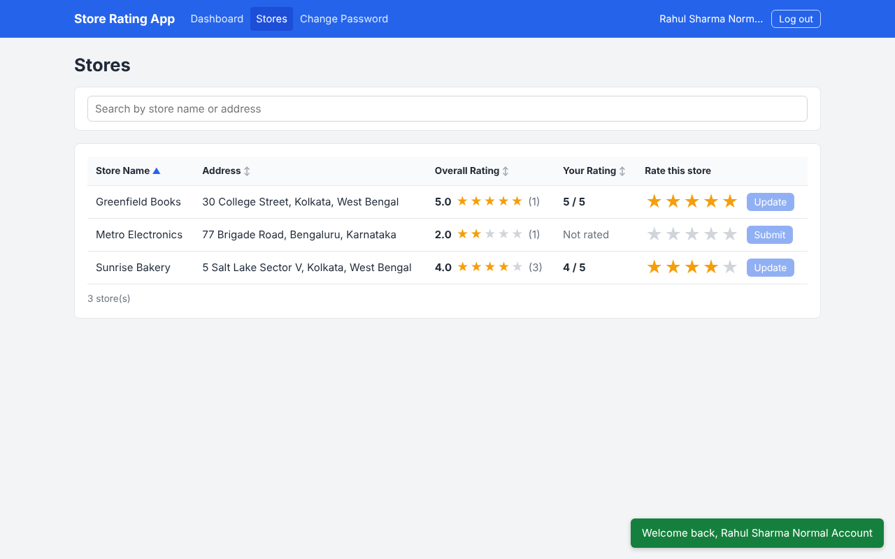
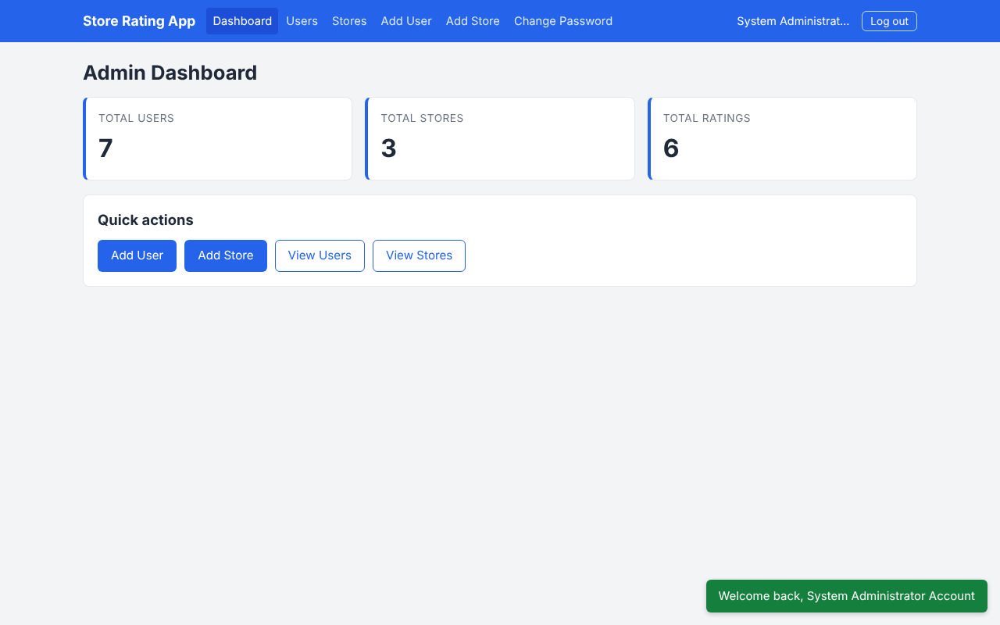
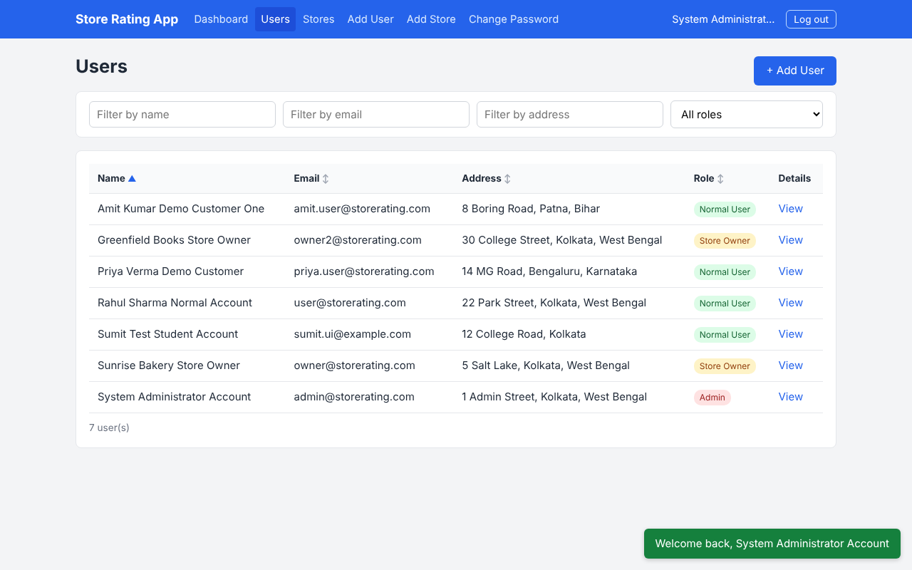
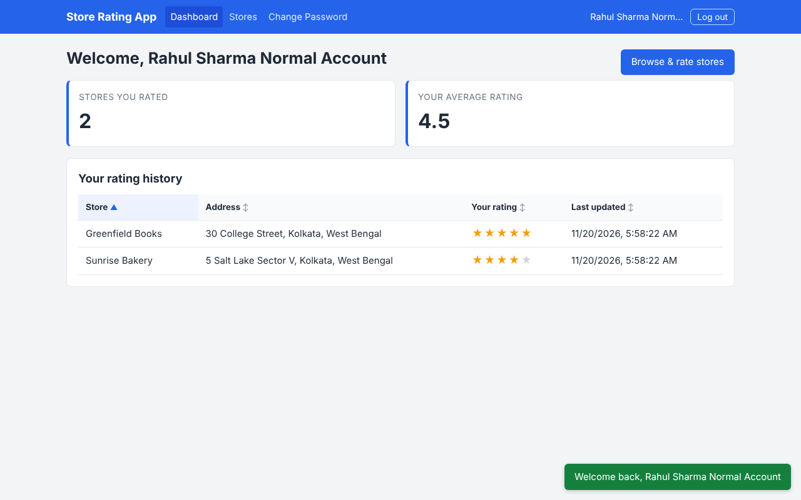
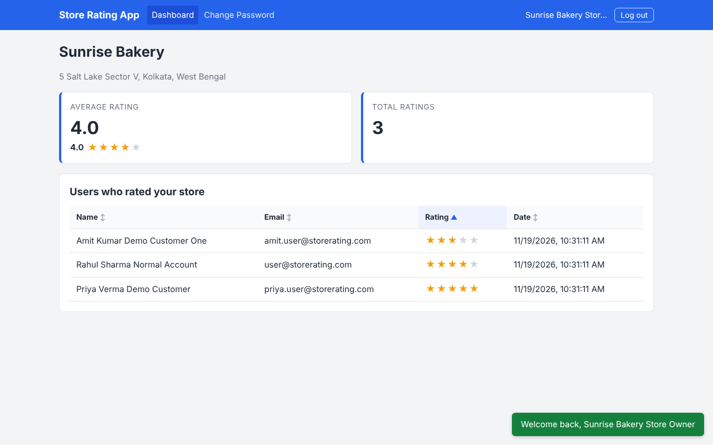

# Store Rating Web Application

A full-stack web app where people register, log in, browse stores and rate them from 1 to 5 stars.
There are three roles that share **one login page**: System Administrator, Normal User and Store Owner.
After login, each role is sent to its own dashboard.

Built for a Full Stack Intern Coding Challenge (React + Express + MySQL).

## Contents

1. [Features](#features)
2. [Screenshots](#screenshots)
3. [Tech stack](#tech-stack)
4. [Project structure](#project-structure)
5. [Setup on Windows (PowerShell), step by step](#setup-on-windows-powershell-step-by-step)
6. [Demo accounts](#demo-accounts)
7. [Running the tests and the production build](#running-the-tests-and-the-production-build)
8. [Resetting the database (careful)](#resetting-the-database-careful)
9. [Validation rules](#validation-rules)
10. [API documentation](#api-documentation)
11. [How the important parts work](#how-the-important-parts-work)
12. [Security measures](#security-measures)
13. [Known limitations](#known-limitations)
14. [Troubleshooting](#troubleshooting)

---

## Features

**System Administrator**
- Dashboard with total users, total stores and total ratings.
- Add stores, normal users and admin users (and store owners).
- List of stores with name, email, address and average rating.
- List of users with name, email, address and role.
- Search and filter by name, email, address and role; sort any column ascending or descending.
- View one user's details. For a store owner, the store's rating is shown too.

**Normal User**
- Sign up and log in; change password.
- See all stores with name, address, overall average rating and **your own rating**.
- Search stores by name or address; sort by name, address or rating.
- Rating history on the dashboard, sortable by store, address, your rating or date.
- Submit a rating (1 to 5) and change it later. A user can never have two ratings for the same store:
  changing a rating updates the original row.

**Store Owner**
- Log in; change password.
- See the average rating of **their own store only** and the list of users who rated it.

**Everyone:** log out, loading indicators, error messages, success toasts, responsive layout.

## Screenshots

> The screenshots come from a test run, so a few extra test accounts may appear in them.
> The demo seed itself has 6 users, 3 stores and 5 ratings.

| Login | Store listing (normal user) |
| --- | --- |
|  |  |

| Admin dashboard | Admin users table (filters and sorting) |
| --- | --- |
|  |  |

| User dashboard | Store owner dashboard |
| --- | --- |
|  |  |

## Tech stack

| Part | Technology |
| --- | --- |
| Frontend | React, Vite, React Router DOM, Axios, plain CSS |
| Backend | Node.js, Express, REST API |
| Authentication | JWT (jsonwebtoken), passwords hashed with bcryptjs |
| Security helpers | Helmet (security headers), express-rate-limit (login limit), CORS |
| Database | MySQL 8 with the `mysql2` package |

## Project structure

```
store-rating-web-app/
├── backend/
│   ├── server.js                  starts the server (checks the database connection first)
│   ├── .env.example               template for your private settings (copy it to .env)
│   ├── src/
│   │   ├── app.js                 Express setup: Helmet, CORS, JSON, routes, error handler
│   │   ├── config/db.js           MySQL connection pool
│   │   ├── routes/index.js        every API URL and which role may use it
│   │   ├── middleware/
│   │   │   ├── auth.js            checks the JWT and the user's role
│   │   │   ├── rateLimiter.js     login limit: 10 failed attempts per 15 minutes
│   │   │   └── errorHandler.js    turns errors into JSON responses
│   │   ├── controllers/           thin layer: read the request, call a service, send the response
│   │   ├── services/              the real logic and SQL queries
│   │   └── utils/                 validators, sorting helper, errors, db:setup script
│   └── tests/api-test.js          automated API tests
├── frontend/
│   ├── index.html, vite.config.js
│   └── src/
│       ├── App.jsx                all routes (public, admin, user, owner)
│       ├── pages/                 one file per screen (12 required pages + user details)
│       ├── components/            reusable pieces (stars, tables headers, form field, route guards)
│       ├── layouts/AppLayout.jsx  navbar shown after login
│       ├── context/               login state (AuthContext) and toast messages
│       ├── hooks/                 useForm, useSort, useDebounce
│       ├── services/              Axios setup and one function per API call
│       ├── utils/                 frontend validation rules and role helpers
│       └── styles/global.css
├── database/
│   ├── schema.sql                 creates the tables (safe to run again, never deletes)
│   └── seed.sql                   demo accounts, stores and ratings
├── docs/screenshots/
├── .gitignore
└── README.md
```

---

## Setup on Windows (PowerShell), step by step

These steps use **Windows PowerShell**. Open it from the Start menu. You will need **two PowerShell
windows** at the end (one for the backend, one for the frontend).

### Step 0: What you need installed

1. **Node.js** (LTS version) from <https://nodejs.org>. Check it:
   ```powershell
   node -v
   npm -v
   ```
2. **MySQL Server 8.0** from <https://dev.mysql.com/downloads/installer/>. During installation you choose a
   password for the MySQL `root` user. Remember it, you need it once in step 2. Check that the service is running:
   ```powershell
   Get-Service -Name "MySQL*"
   ```
   The status should be `Running`. If it says `Stopped`, start it (PowerShell as Administrator):
   `Start-Service -Name "MySQL80"` (use the exact name shown by the previous command).
3. **VS Code** (optional, any editor works).

> **If `npm` says "running scripts is disabled on this system":** run this once, then open a new PowerShell window:
> ```powershell
> Set-ExecutionPolicy -Scope CurrentUser -ExecutionPolicy RemoteSigned
> ```
> (Or type `npm.cmd` instead of `npm`.)

### Step 1: Unzip the project

```powershell
Expand-Archive -Path "$HOME\Downloads\store-rating-web-app.zip" -DestinationPath "$HOME\Projects"
cd "$HOME\Projects\store-rating-web-app"
```

If you got the project another way, simply `cd` into the project folder.

### Step 2: Create a separate MySQL user (do not run the app as `root`)

The app should connect with its own MySQL user that can only touch its own database. That way a bug or a
leaked password cannot damage anything else on your computer.

Open the MySQL command line and log in as root. It asks for the root password you chose in step 0:

```powershell
mysql -u root -p
```

> **If PowerShell says `mysql` is not recognized**, use the full path instead (adjust the version folder if yours differs):
> ```powershell
> & "C:\Program Files\MySQL\MySQL Server 8.0\bin\mysql.exe" -u root -p
> ```
> (Alternative without the command line: open **MySQL Workbench**, connect as root, and run the SQL below in a query tab.)

When you see the `mysql>` prompt, paste these lines. **Replace `ChangeThisPassword1` with a password of your own**
(use only letters, numbers and `!` or `@`, so it works in the `.env` file without quoting):

```sql
CREATE DATABASE IF NOT EXISTS store_rating CHARACTER SET utf8mb4 COLLATE utf8mb4_unicode_ci;
CREATE USER IF NOT EXISTS 'store_app_user'@'localhost' IDENTIFIED BY 'ChangeThisPassword1';
GRANT ALL PRIVILEGES ON store_rating.* TO 'store_app_user'@'localhost';
FLUSH PRIVILEGES;
EXIT;
```

What this does: creates an empty database called `store_rating`, creates the user `store_app_user`, and gives that
user full rights **only on `store_rating`** (nothing else on the server).

If you ever forget that password: log in as root again and run
`ALTER USER 'store_app_user'@'localhost' IDENTIFIED BY 'NewPassword1';`

### Step 3: Configure and start the backend

```powershell
cd backend
Copy-Item .env.example .env
notepad .env
```

In Notepad, fill in these values and save:

| Setting | What to put |
| --- | --- |
| `DB_USER` | `store_app_user` (already there) |
| `DB_PASSWORD` | the password you chose in step 2 |
| `DB_NAME` | `store_rating` (already there) |
| `JWT_SECRET` | a long random string (see below) |

Generate a good `JWT_SECRET` and paste it after `JWT_SECRET=`:

```powershell
node -e "console.log(require('crypto').randomBytes(48).toString('hex'))"
```

`.env` holds your private settings. It is listed in `.gitignore`, so it is never uploaded to GitHub. Never share it.

Now install the packages, create the tables with the demo data, and start the server:

```powershell
npm install
npm run db:setup
npm start
```

What you should see:

- after `db:setup`: `Database ready: 5 ratings, 3 stores, 6 users`
- after `npm start`: `MySQL connection OK` and `API running on http://localhost:5000`

Leave this window open. You can test the API in a browser at <http://localhost:5000/api/health>
(it shows `{"status":"ok"}`).

### Step 4: Start the frontend (second PowerShell window)

Open a **new** PowerShell window:

```powershell
cd "$HOME\Projects\store-rating-web-app\frontend"
npm install
npm run dev
```

Open **<http://localhost:5173>** in your browser and log in with a [demo account](#demo-accounts).

During development, Vite forwards every `/api` request to the backend on port 5000, so you do not need any extra
configuration.

### Step 5: Stop the app

Press `Ctrl + C` in each PowerShell window.

---

## Demo accounts

`npm run db:setup` loads these accounts. They are **for local demos only** and their passwords are public in this
README, so never use them on a real server.

| Role | Email | Password | Notes |
| --- | --- | --- | --- |
| System Administrator | `admin@storerating.com` | `Admin@123` | |
| Normal User | `user@storerating.com` | `User@1234` | has rated 2 stores |
| Normal User | `priya.user@storerating.com` | `User@1234` | |
| Normal User | `amit.user@storerating.com` | `User@1234` | |
| Store Owner | `owner@storerating.com` | `Owner@123` | owns "Sunrise Bakery" |
| Store Owner | `owner2@storerating.com` | `Owner@123` | owns "Greenfield Books" |

Passwords are stored in the database only as bcrypt hashes, never as plain text.

---

## Running the tests and the production build

**API tests** (the backend must be running, see step 3):

```powershell
cd backend
npm test
```

- They run about 165 checks: login for every role, signup and validation limits, role-based access (403s), duplicates
  (409), ratings (submit, update, averages), search/filter/sort, owner isolation, password change, security headers and
  the login rate limit.
- They are **repeatable**. Every run creates its own users and stores (emails like `user1.<runid>@apitest.example`),
  never touches the demo accounts or demo ratings, and at the end deletes **only** the rows it created. No reset is
  needed between runs. Use `npm test -- --keep` to keep the test rows so you can look at them in MySQL.
- The tests log in once as the demo admin. If you changed the admin password, run with
  `$env:TEST_ADMIN_PASSWORD="your-password"; npm test`.
- Run them against a development database, not one holding data you care about, because they briefly add test rows.

**Production build of the frontend** (checks that the code compiles):

```powershell
cd frontend
npm run build
```

This creates the `frontend/dist` folder (ignored by Git). To serve a production build you need a web server and the
`VITE_API_URL` setting (see `frontend/.env.example`); that is outside this project's scope.

> The project does not contain automated browser (frontend) tests. The screens were checked with a separate
> Playwright script during development.

---

## Resetting the database (careful)

`npm run db:setup` is **safe**:

- It creates tables that are missing and loads the demo data **only into an empty database**.
- If the database already contains data, it **refuses to continue**, changes nothing and tells you so.
- `database/schema.sql` only uses `CREATE ... IF NOT EXISTS`, so running it again never deletes anything.

To **erase everything** (all users, stores and ratings) and start again with the demo data, you must say so explicitly:

```powershell
cd backend
npm run db:setup -- --force
```

`--force` drops the `users`, `stores` and `ratings` tables. It cannot be undone. Never use it on data you want to keep.

---

## Validation rules

Checked in the browser **and** again on the server (the server never trusts the browser).

| Field | Rule |
| --- | --- |
| Name (user) | 20 to 60 characters |
| Store name | required, up to 100 characters. The challenge PDF lists "Name: 20 to 60 characters" under general form validations without saying it applies to stores, so it is applied to people's names only |
| Address | required, up to 400 characters |
| Password | 8 to 16 characters, at least one uppercase letter and one special character. A special character is anything that is not a letter, a digit or a space: `!`, `_` and `€` count, but a letter such as `é` does not |
| Email | standard email format: no leading, trailing or double dots, a valid domain, a top-level domain of 2 or more letters (so `a..b@x.com`, `a@x` and `a@x.123` are rejected); must be unique (stored in lower case) |
| Rating | whole number from 1 to 5 |

---

## API documentation

**Base URL:** `http://localhost:5000/api`
**Format:** JSON requests and responses.
**Authentication:** send the token you get from login in every private request:
`Authorization: Bearer <token>`

You can test everything with Postman: first call `POST /auth/login`, copy the `token`, then set it as a Bearer token.

### Errors

Every error looks like this:

```json
{ "message": "Validation failed", "errors": { "name": "Name must be at least 20 characters", "password": "Password is required" } }
```

`errors` (one message per form field) is only present for validation and conflict problems.

| Status | Meaning |
| --- | --- |
| 200 / 201 | OK / created |
| 400 | invalid input (see `errors`) |
| 401 | not logged in, wrong login details, or invalid/expired token |
| 403 | logged in, but your role may not use this endpoint |
| 404 | not found (also: owner with no store linked yet) |
| 409 | conflict: email already registered, store email taken, owner already has a store, store already rated by this user |
| 429 | too many failed logins; wait 15 minutes (see the `Retry-After` header) |
| 500 | unexpected server error |

### Authentication endpoints

| Method | URL | Who | Body | Purpose |
| --- | --- | --- | --- | --- |
| POST | `/auth/signup` | public | `name`, `email`, `address`, `password` | create a **normal user** account (the role cannot be chosen) and log in |
| POST | `/auth/login` | public | `email`, `password` | log in |
| POST | `/auth/logout` | any logged-in user | none | explicit logout call (the browser deletes the token) |
| GET | `/auth/me` | any logged-in user | none | who am I |
| PUT | `/auth/password` | any logged-in user | `currentPassword`, `newPassword` | change password |

Login request and response:

```json
POST /auth/login
{ "email": "admin@storerating.com", "password": "Admin@123" }

200 OK
{ "token": "<jwt>", "user": { "id": 1, "name": "System Administrator Account", "email": "admin@storerating.com", "address": "1 Admin Street, Kolkata, West Bengal", "role": "admin" } }
```

Login is limited to **10 failed attempts per 15 minutes** for each IP address and email. The 11th failed attempt returns `429`.
Successful logins are not counted.

### Admin endpoints (role `admin`)

| Method | URL | Purpose |
| --- | --- | --- |
| GET | `/admin/stats` | `{ "totalUsers": 6, "totalStores": 3, "totalRatings": 5 }` |
| GET | `/admin/users` | list users. Query: `name`, `email`, `address`, `role` (`admin`, `user` or `owner`), `sortBy` (`id`, `name`, `email`, `address`, `role`), `order` (`asc` or `desc`) |
| POST | `/admin/users` | add a user. Body: `name`, `email`, `address`, `password`, `role` |
| GET | `/admin/users/:id` | one user's details. For a store owner it includes `store` with `average_rating` and `rating_count` |
| GET | `/admin/stores` | list stores. Query: `name`, `email`, `address`, `sortBy` (`id`, `name`, `email`, `address`, `average_rating`), `order` |
| POST | `/admin/stores` | add a store. Body: `name`, `email`, `address`, optional `ownerId` (an owner without a store) |
| GET | `/admin/owners/available` | store owners who do not have a store yet |

Filters use "contains" matching and can be combined, for example `/admin/users?role=owner&address=kolkata&sortBy=name&order=desc`.

Store row example:

```json
{ "id": 1, "name": "Sunrise Bakery", "email": "contact@sunrisebakery.com", "address": "5 Salt Lake Sector V, Kolkata, West Bengal", "average_rating": "4.0", "rating_count": 3 }
```

`average_rating` is a text value with one decimal (`"4.0"`), or `null` when the store has no ratings yet.

### Normal user endpoints (role `user`)

| Method | URL | Purpose |
| --- | --- | --- |
| GET | `/stores` | all stores with the overall rating and your own rating. Query: `search` (matches name **or** address), `sortBy` (`id`, `name`, `address`, `average_rating`, `my_rating`), `order` |
| POST | `/stores/:storeId/rating` | submit your **first** rating for a store. Body: `{ "rating": 4 }`. A second POST returns 409 |
| PUT | `/stores/:storeId/rating` | change your existing rating. Body: `{ "rating": 5 }`. Returns 404 if you have not rated yet |
| GET | `/ratings/me` | your rating history. Query: `sortBy` (`store_name`, `store_address`, `rating`, `date`), `order`. Without `sortBy` the newest change comes first |

Store row for a user: `{ "id": 1, "name": "Sunrise Bakery", "address": "...", "average_rating": "4.0", "rating_count": 3, "my_rating": 4 }`
(`my_rating` is `null` when you have not rated the store).

### Store owner endpoints (role `owner`)

| Method | URL | Purpose |
| --- | --- | --- |
| GET | `/owner/dashboard` | your own store with `average_rating`, plus `raters` (name, email, rating, date). Query: `sortBy` (`name`, `email`, `rating`, `date`), `order`. The store is found from your login, so you can never see another owner's store |

### Other

| Method | URL | Purpose |
| --- | --- | --- |
| GET | `/health` | `{ "status": "ok" }`, no login needed |

---

## How the important parts work

- **One login for three roles.** `POST /auth/login` checks the password with bcrypt and returns a JWT that contains only
  the user id. On every private request, `middleware/auth.js` verifies the token and loads the user **from the database**,
  so the role always comes from the database and never from the browser. `authorize('admin')` etc. in `routes/index.js`
  then allows or blocks the endpoint (403).
- **One rating per user per store.** The `ratings` table has `UNIQUE (user_id, store_id)`, so MySQL itself rejects
  duplicates, even if two requests arrive at the same moment. Changing a rating runs an `UPDATE` on the existing row.
- **Average rating.** Calculated in SQL (`ROUND(AVG(rating), 1)` with a `LEFT JOIN`), so stores without ratings still
  appear, with `null`.
- **Sorting and filtering happen in MySQL.** The frontend sends `sortBy`, `order` and filters as query parameters. The
  server only accepts column names from a fixed whitelist and uses `?` placeholders for values, which prevents SQL injection.
- **Store owners see only their store.** `stores.owner_id` links a store to its owner; the owner dashboard looks the store
  up by the logged-in user's id.
- **Frontend route guards.** `ProtectedRoute` sends logged-out users to the login page and users with the wrong role to
  their own dashboard. This only hides screens, the real protection is the role check on the server.

## Security measures

- Passwords hashed with bcrypt (cost 10); no plain-text passwords anywhere, including the demo data.
- JWT secret and database credentials live in `.env`, which is excluded from Git.
- Role is verified on the server for every private endpoint.
- Login rate limit (10 failed attempts per 15 minutes per IP and email).
- Unknown emails cost the same time as wrong passwords (dummy bcrypt comparison), and both give the same message, so
  attackers cannot find out which emails are registered.
- Helmet security headers; the `X-Powered-By` header is removed.
- CORS only allows the origin from `CLIENT_ORIGIN`.
- Parameterised SQL queries and whitelisted sort columns.
- The app connects with a dedicated MySQL user that only has rights on its own database.
- `db:setup` never deletes data unless you pass `--force`.

## Known limitations

These are known and deliberate trade-offs for a small learning project:

- **Logging out does not cancel the token.** JWTs are stateless: after logout the browser deletes the token, but a copy of
  the token would still work until it expires (1 day). The same applies after a password change. Fixing this needs a
  token blacklist or refresh tokens, which were not implemented.
- **The token is kept in the browser's `localStorage`.** If the site ever had a cross-site scripting (XSS) bug, a script
  could read it. HTTP-only cookies would be safer but were not implemented.
- **The login limit is kept in the server's memory.** It resets when the server restarts, is not shared between several
  server copies, and counts per IP address and email, so one IP trying many different emails is not limited. Behind a
  reverse proxy you would also need to configure Express `trust proxy` so the real client IP is used.
- Sign-up is not rate limited. There is no email verification and no "forgot password" feature.
- No pagination: lists load all rows (fine for a demo, slow for thousands of rows).
- The admin can add users and stores but cannot edit or delete them (not required by the challenge).
- A store owner can own one store only.
- On a small phone screen, the "Rate this store" column sits at the right edge of the table and needs a sideways scroll.
- Store names are limited to 100 characters but have no minimum; the 20 to 60 character rule applies to people's names.
- The frontend has no automated tests inside the repository, and a production hosting setup is not included.
- The setup steps were tested on Linux. The Windows commands use standard PowerShell syntax but have not been run on a
  Windows machine by the author of this README.
- The demo accounts have public passwords. Do not use them on a real server.

## Troubleshooting

| Problem | What to do |
| --- | --- |
| `npm` : running scripts is disabled | `Set-ExecutionPolicy -Scope CurrentUser -ExecutionPolicy RemoteSigned`, then open a new PowerShell window. |
| `mysql` is not recognized | Use the full path: `& "C:\Program Files\MySQL\MySQL Server 8.0\bin\mysql.exe" -u root -p`, or use MySQL Workbench. |
| `Could not connect to MySQL` when starting the backend | The MySQL service is not running (`Get-Service "MySQL*"`, then `Start-Service`), or `DB_USER` / `DB_PASSWORD` in `backend\.env` are wrong. |
| `Access denied for user 'store_app_user'` | The password in `.env` does not match step 2. Reset it with `ALTER USER 'store_app_user'@'localhost' IDENTIFIED BY '...';` as root. |
| `JWT_SECRET is missing` | You did not create `backend\.env`, or `JWT_SECRET` is empty (step 3). |
| `Database "store_rating" already contains data ... Nothing was changed` | That is the safety feature working. Your data is fine. Use `--force` only if you really want to erase it. |
| Login page says "Cannot reach the server" | The backend window is closed or crashed. Start it again with `npm start` in `backend`. |
| "Too many failed login attempts" | Wait 15 minutes, or restart the backend (the limit is in memory). |
| Port 5000 or 5173 is already in use | Find the program with `netstat -ano \| findstr :5000`, close it, or change `PORT` in `.env` (and the proxy target in `frontend\vite.config.js`). |
| `npm test` says the backend is not reachable | Start the backend first (step 3), in another window. |
